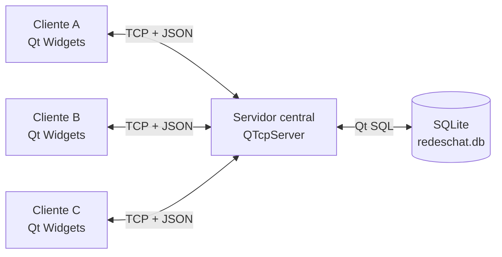

# Relatório técnico: RedesChat

**Disciplina:** Redes de Computadores II  
**Autores:** preencher nomes da dupla  
**Data:** preencher data da entrega

## 1. Objetivo

O projeto implementa um sistema de chat cliente-servidor para comunicação em tempo real entre múltiplos usuários. Um servidor central autentica as conexões, mantém o estado das sessões e encaminha mensagens, eventos de presença e arquivos.

A mesma aplicação gráfica pode ser iniciada como servidor ou cliente. O endereço e a porta são configuráveis para permitir execução em máquinas distintas da mesma rede local.

## 2. Tecnologias

| Componente | Escolha |
|---|---|
| Linguagem | C++20 |
| Interface | Qt 6 Widgets |
| Rede | Qt Network (`QTcpServer` e `QTcpSocket`) |
| Transporte | TCP sobre IPv4 |
| Serialização | JSON UTF-8 |
| Persistência | SQLite pelo Qt SQL |
| Compilação | Xmake |
| Plataforma-alvo | Linux x86_64 |

## 3. Arquitetura

O sistema segue uma arquitetura cliente-servidor centralizada. Clientes não estabelecem conexões diretas entre si. Toda operação passa pelo servidor, inclusive mensagens privadas e arquivos.



### 3.1 Componentes

```text
MainWindow
  interface, navegação, salas, mensagens e arquivos

ChatClient
  conexão TCP, framing, comandos e eventos recebidos

ChatServer
  sessões, autenticação, presença, roteamento e transferências

MessageProtocol
  prefixo de tamanho, JSON e buffer incremental

Database
  contas, salas e histórico em SQLite
```

### 3.2 Concorrência

O projeto utiliza processamento assíncrono orientado a eventos, sem criar uma thread por cliente. `QTcpServer` e `QTcpSocket` integram-se ao event loop do Qt e notificam a aplicação por eventos como:

- `newConnection`: nova conexão pendente.
- `readyRead`: bytes disponíveis sem bloquear a interface.
- `disconnected`: encerramento normal ou queda da conexão.
- `errorOccurred`: erro de socket.

Cada socket possui uma `ClientSession` própria, contendo buffer de recepção, estado do handshake, usuário autenticado e salas participantes. Esse modelo permite múltiplos clientes simultâneos sem bloquear a GUI.

## 4. Justificativa da escolha do TCP

TCP foi escolhido porque o chat precisa preservar mensagens, ordem e integridade dos arquivos.

### 4.1 Confiabilidade

TCP usa números de sequência, confirmações e retransmissões para recuperar segmentos perdidos enquanto a conexão estiver válida. Em UDP, seria necessário implementar confirmações, temporizadores, retransmissão, deduplicação e remontagem na aplicação.

### 4.2 Ordenação

TCP entrega os bytes na ordem correta. Isso é importante para conversas e indispensável para os blocos de arquivo. A aplicação ainda valida offsets e SHA-256, mas não precisa reordenar datagramas.

### 4.3 Controle de fluxo

A janela de recepção do TCP impede que um emissor envie indefinidamente mais dados do que o receptor consegue consumir. O mecanismo é útil quando um cliente ou servidor está temporariamente mais lento.

### 4.4 Controle de congestionamento

TCP adapta a taxa de transmissão às condições da rede. Isso reduz o risco de agravar congestionamento durante transferências de arquivo ou uso simultâneo por vários clientes.

### 4.5 Desempenho e experiência

UDP possui menor overhead e pode ser preferível para voz ou vídeo em tempo real, nos quais uma perda ocasional é aceitável. No chat, uma pequena latência adicional é menos prejudicial do que perder, duplicar ou inverter mensagens. Na rede local do laboratório, o overhead do TCP é pequeno em relação aos benefícios.

### 4.6 Limite de mensagens

TCP é um fluxo de bytes e não preserva chamadas de `write()`. O protocolo próprio resolve isso com 4 bytes big-endian contendo o tamanho do JSON. O receptor acumula dados até formar um frame completo e também processa vários frames concatenados.

## 5. Protocolo de aplicação

O formato geral é:

```text
[uint32 tamanho em big-endian][JSON UTF-8 compacto]
```

O payload máximo é 1 MiB. Depois de conectar, o cliente negocia a versão com `hello`. Cadastro e login são permitidos após o handshake; operações de chat exigem autenticação.

Categorias implementadas:

- Handshake e erros.
- Cadastro e login.
- Presença e listagem.
- Mensagens de sala e privadas.
- Criação, entrada e saída de salas.
- Histórico persistente.
- Oferta, aceite, blocos e conclusão de arquivos.

A especificação completa, com exemplos JSON, está em [protocol.md](protocol.md).

## 6. Autenticação

O cadastro aceita qualquer senha, inclusive vazia, e exige apenas um apelido não vazio e ainda não utilizado. Os apelidos são sensíveis a maiúsculas.

O servidor não armazena a senha diretamente. Para cada usuário:

1. Gera um salt aleatório de 16 bytes.
2. Deriva um hash SHA-256 iterado.
3. Persiste apenas apelido, hash e salt.
4. Repete a derivação durante o login para comparar o resultado.

O mesmo usuário não pode manter duas sessões simultâneas.

## 7. Salas e mensagens

Após autenticar, todo cliente entra em `geral`. Essa sala não pode ser abandonada. Salas adicionais são persistentes e cada sessão pode participar de várias simultaneamente.

O servidor mantém um conjunto de sockets para cada sala. Ao receber uma mensagem, verifica se a sessão pertence à sala antes de encaminhar somente aos seus membros.

Mensagens privadas são entregues apenas ao destinatário e ao remetente. O campo `sender` é gerado pelo servidor a partir da sessão, impedindo que o cliente escolha outro remetente.

## 8. Persistência

SQLite foi escolhido porque não exige daemon, porta, usuário administrativo ou configuração externa. Todo o banco fica em um arquivo criado automaticamente pelo servidor.

Tabelas:

```text
users
  username, password_hash, salt

rooms
  name, created_at

room_messages
  id, room, sender, content, created_at
```

Ao entrar em uma sala, o cliente recebe as últimas 100 mensagens em ordem cronológica. Participações e usuários online permanecem em memória porque deixam de existir quando a conexão termina.

## 9. Transferência de arquivos

Arquivos são privados e passam pelo servidor. O destinatário pode aceitar ou recusar e escolhe o caminho de gravação.

- Limite: 10 MiB.
- Blocos: 32 KiB antes de Base64.
- Integridade: SHA-256.
- Controle: identificador UUID e offset por bloco.
- Falhas: recusa, bloco inválido ou desconexão cancelam a transferência.

O servidor não salva o conteúdo; apenas mantém o estado temporário e encaminha os frames.

## 10. Tratamento de erros

Casos tratados:

- Servidor indisponível e conexão recusada.
- Timeout de conexão após cinco segundos.
- IP ou hostname incorreto.
- Porta inválida na interface.
- Frame excessivo ou JSON inválido.
- Versão incompatível do protocolo.
- Apelido duplicado ou credenciais incorretas.
- Segunda sessão do mesmo usuário.
- Sala inexistente ou envio sem participação.
- Destinatário privado offline.
- Arquivo excessivo, recusa, offset incorreto ou desconexão.
- Queda de cliente, com remoção de salas e notificações de saída.

## 11. Testes automatizados realizados

| Teste | Cobertura | Resultado atual |
|---|---|---|
| `protocol_tests` | Fragmentação, concatenação e frame excessivo | Aprovado |
| `database_tests` | Conta, senha, sala, histórico e reabertura do banco | Aprovado |
| `network_smoke` | Três clientes, autenticação, presença, broadcast, privado e isolamento de sala | Aprovado |
| `file_transfer_smoke` | Arquivo binário de 90.000 bytes em vários blocos e comparação byte a byte | Aprovado |
| GUI offscreen | Inicialização da interface sem falha | Aprovado |
| Portáteis sem rede | Inicialização do AppImage, `.run` e ZIP em namespace sem rede, usando a plataforma `offscreen` | Aprovado |
| Dependências portáteis | Auditoria por `ldd` do executável, plugins e bibliotecas empacotadas | Aprovado |

Os testes automatizados usam loopback. Eles verificam a lógica, mas não substituem perda de conectividade, firewall e compatibilidade entre máquinas físicas.

## 12. Testes em rede real

**Estado:** pendente de execução e registro.

O ensaio deve usar uma máquina como servidor e ao menos duas como clientes. Após executá-lo, preencher:

| Item | Resultado |
|---|---|
| Distribuição e versão do servidor | preencher |
| Distribuições dos clientes | preencher |
| IPv4 e porta utilizados | preencher |
| Broadcast entre três máquinas | preencher |
| Mensagem privada | preencher |
| Entrada e saída de salas | preencher |
| Transferência de arquivo | preencher |
| Queda abrupta de cliente | preencher |
| IP incorreto e servidor indisponível | preencher |
| Ajuste de firewall necessário | preencher |

O procedimento detalhado está em [teste-laboratorio.md](teste-laboratorio.md).

## 13. Dificuldades e soluções

### Fronteiras de mensagem no TCP

Inicialmente, uma mensagem JSON não poderia ser associada diretamente a um evento `readyRead`. A solução foi criar framing por tamanho e buffers independentes por socket.

### Integração do Qt com Xmake

O Xmake fornecia wrappers para Widgets e Network, mas não para Qt SQL. Foi criado um wrapper local mínimo `qt6sql` que reutiliza o mesmo SDK Qt 6.9.1 e expõe `Qt6Sql` sem introduzir outra instalação.

### Ambiente WSL

WSL é adequado para desenvolvimento com WSLg, mas WSL2 normalmente usa rede virtual/NAT. Por isso, testes locais não devem ser considerados equivalentes ao laboratório em Linux nativo.

### Compatibilidade do pacote Linux

O comando `scripts/build-portable.sh` recompila o projeto dentro de um rootfs Ubuntu 22.04 e gera AppImage, executável `.run` autoextraível e ZIP. Qt, plugins e dependências não pertencentes à glibc acompanham os artefatos. Uma auditoria rejeita símbolos posteriores a `GLIBC_2.35`, e os três formatos são iniciados em um namespace sem rede antes do teste físico.

### Eventos assíncronos em testes

Conexão, handshake, autenticação e mensagens chegam em momentos diferentes. Os testes foram escritos como pequenos cenários orientados a callbacks, com timeout para detectar estados não alcançados.

### Persistência simples

SQLite foi adotado para evitar um serviço externo. O servidor cria schema, índices e sala `geral` automaticamente.

### Arquivos sobre JSON

JSON não transporta bytes arbitrários diretamente. Os blocos são convertidos para Base64, aceitando aproximadamente 33% de overhead em troca de simplicidade e integração com o protocolo existente.

## 14. Limitações e melhorias futuras

- O transporte não usa TLS; captura de rede pode revelar credenciais e mensagens.
- A derivação de senha é didática e deve ser substituída por Argon2id, scrypt ou PBKDF2 em produção.
- Mensagens privadas não são persistidas.
- Arquivos são carregados em memória e limitados a 10 MiB.
- O pacote portátil ainda precisa ser validado na distribuição do laboratório.
- A aplicação usa IPv4; suporte completo a IPv6 pode ser adicionado futuramente.

## 15. Conclusão

O projeto demonstra sockets TCP, protocolo de aplicação, processamento assíncrono, autenticação, roteamento centralizado, persistência e transferência de arquivos. A escolha de TCP simplificou confiabilidade, ordenação e controle de tráfego, enquanto Qt permitiu integrar rede e GUI no mesmo event loop.

Antes da entrega, devem ser concluídos a validação do pacote portátil e o teste registrado em três máquinas Linux reais.
